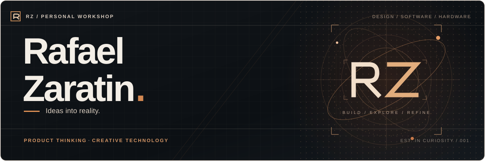
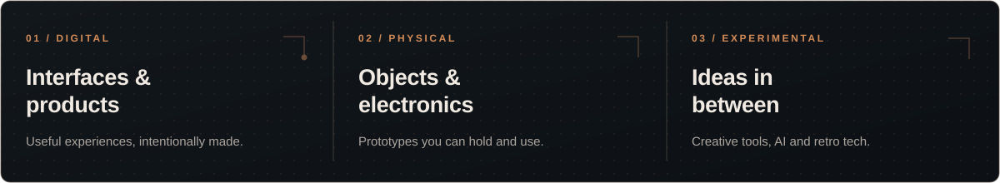

  

  <strong>Making ideas tangible.</strong> 
  Product design &nbsp;·&nbsp; Creative development &nbsp;·&nbsp; Physical computing

---

### Hello, I'm Rafael.

I’m **Rafael Zaratin** — a maker with a background in product design and a curiosity that moves between the digital and the physical.

I like taking ideas from the first sketch to something that actually works: thoughtful interfaces, small electronic devices, and creative experiments. To me, good technology is not only about **what it does**, but also **how it feels**.

### Inside the workshop

  

### The way I build

**Think clearly. Prototype early. Test honestly. Refine with care.**

My process connects product thinking, hands-on experimentation, and practical engineering. I document decisions, build in small steps, and keep learning as things take shape. Some repositories are finished applications; others are sketches or work in progress — both have a place here.

---

  <strong>RZ / PERSONAL WORKSHOP</strong> &nbsp;·&nbsp; Built with curiosity. Refined with care. 
  <a href="https://github.com/Rafazara?tab=repositories">Browse the workshop</a>

